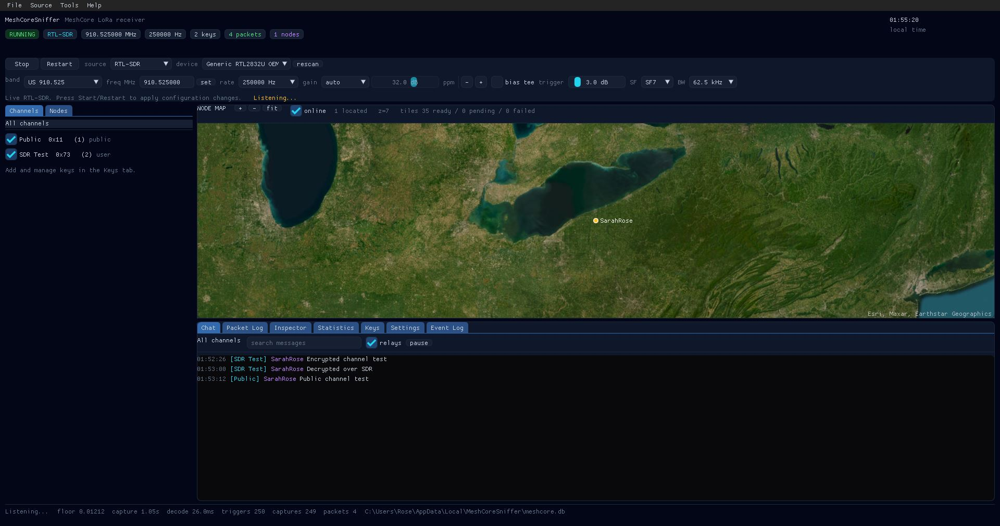
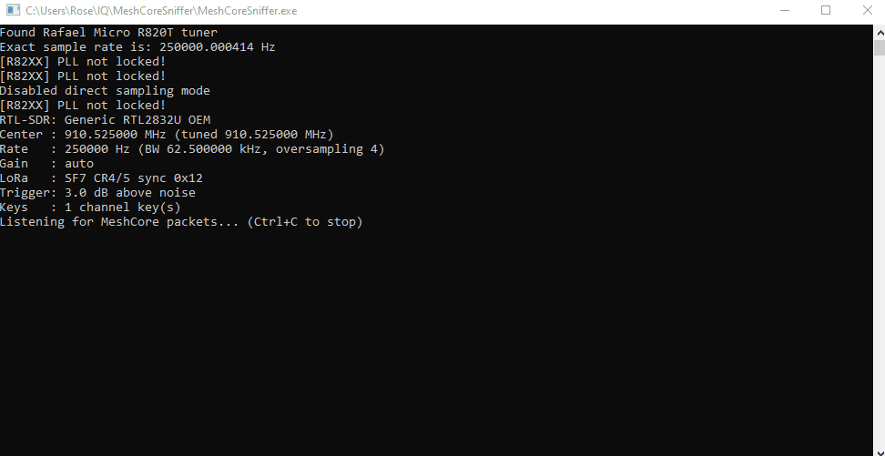
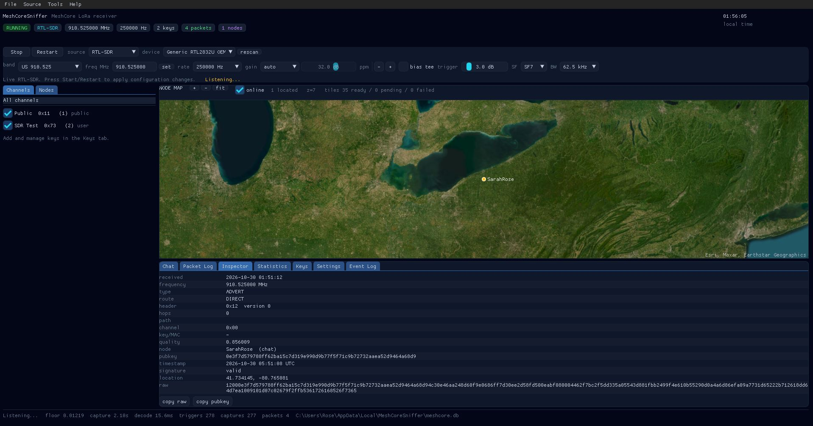
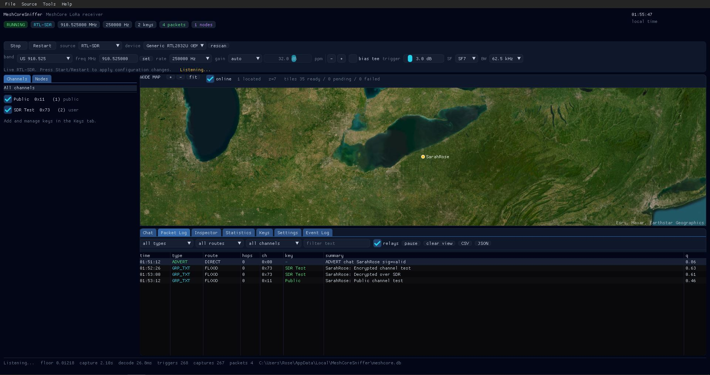

# MeshCoreSniffer

A small C++17 receiver for **MeshCore** LoRa traffic, using an **RTL-SDR** or a
recorded IQ WAV file.

Defaults are the MeshCore **USA** preset: **910.525 MHz, SF7, BW 62.5 kHz,
CR 4/5, sync word 0x12**.

## Features

- Live RTL-SDR receive is the default — no `--rtl` flag needed.
- Decodes MeshCore v1 group text/data, adverts and raw/custom packets.
- Built-in public-channel key; add private channel keys with `--key`.
- Adverts show node type, name, public key, timestamp, location and a verified
  Ed25519 signature.
- Group messages show the channel hash, hop count/path and decrypted text.
- Offline IQ WAV decoding (`--iq`) prints every packet in the recording.
- Sensitive demodulator: soft-decision FEC, automatic CFO and timing recovery.
- **Optional desktop GUI** (`MeshCoreSniffer-gui.exe`): live map, chat channels,
  node list, packet inspector, key manager and SQLite history.

## Screenshots





| Packet inspector | Packet log |
|---|---|
|  |  |

## Build

Windows + MSYS2 MinGW-w64:

```powershell
cd C:\Users\Rose\IQ\MeshCoreSniffer
.\build.cmd
```

`build.ps1` and CMake are also provided. For live mode, install
`mingw-w64-x86_64-rtl-sdr`; librtlsdr is loaded at runtime, so offline IQ
decoding works without it.

### GUI build

```powershell
pacman -S --needed mingw-w64-x86_64-gcc mingw-w64-x86_64-cmake `
    mingw-w64-x86_64-ninja mingw-w64-x86_64-pkgconf `
    mingw-w64-x86_64-glfw mingw-w64-x86_64-sqlite3 `
    mingw-w64-x86_64-rtl-sdr
.\build_gui.cmd
```

This builds `MeshCoreSniffer-gui.exe` without touching the CLI binary. The
script also copies the required runtime DLLs next to it.

## Usage

Live RTL-SDR (default):

```powershell
.\MeshCoreSniffer.exe
.\MeshCoreSniffer.exe --freq 869.525
.\MeshCoreSniffer.exe --gain 30 --ppm 5
```

IQ WAV input:

```powershell
.\MeshCoreSniffer.exe --iq capture.wav      # decode every packet
.\MeshCoreSniffer.exe capture.wav           # decode the first packet
```

| Option | Description |
|---|---|
| `--freq VALUE` | Center frequency, e.g. `910.525` (MHz) or `910525000` (Hz). Default `910.525`. |
| `--rate HZ` | RTL-SDR sample rate. Default `250000`; must be an integer multiple of `--bw` (`250000`, `500000`, `1000000`). |
| `--gain auto\|dB` | Tuner gain. Default `auto`. |
| `--ppm N` | RTL-SDR crystal correction. |
| `--device N` | RTL-SDR device index. |
| `--bias-tee` | Enable the bias tee. |
| `--threshold DB` | Live energy trigger above noise. Default `3` dB. |
| `--sf N` / `--bw HZ` | LoRa parameters. Defaults `7` / `62500`. |
| `--key HEX\|B64` | Add a 16- or 32-byte channel key. The public key is always included. |
| `--iq FILE` | Process an IQ WAV through the live trigger/decode path. |
| `--verbose` | Show trigger, header and timing diagnostics. |

## Output

```text
[23:07:09] 910.525 MHz  GRP_TXT  ch=0x11  hops=1  "SarahRose: This is a test"
[23:07:09] 910.525 MHz  ADVERT  chat  name="SarahRose"  loc=41.734145,-80.765081  sig=valid
```

`hops=0` is the node's direct transmission; `hops>0` is a relayed copy.

## GUI

```powershell
.\MeshCoreSniffer-gui.exe
```

The GUI is a receive-only dashboard with the same decoder as the CLI:

- Source: RTL-SDR or IQ WAV, with US/EU band presets and a custom frequency.
- Channels and keys: add/remove/enable 16- or 32-byte keys; the public key is
  always enabled. Channel names are local labels (they are not transmitted).
- Chat: group text grouped by channel, with sender, hops and timestamps.
- Nodes and map: adverts with location appear on the slippy map.
- Packet log and inspector: filters, raw hex, path/hops, MAC and decoded fields.
- Statistics and event log; CSV/JSON export.
- SQLite history, keys and settings under `%LOCALAPPDATA%\MeshCoreSniffer`.
- Map tiles are cached there too. Override the provider with
  `MESHCORE_TILE_URL`, `MESHCORE_TILE_UA` and `MESHCORE_TILE_KEY`.

Command-line helpers for the GUI:

```powershell
.\MeshCoreSniffer-gui.exe --wav capture.wav --start --exit-after 15
.\MeshCoreSniffer-gui.exe --live --start
```

The GUI does not send messages. The console `MeshCoreSniffer.exe` is unchanged.

## Notes

- Live mode defaults to a 250 kHz sample rate: 4x oversampling of the 62.5 kHz
  channel. Higher rates (500 kHz, 1 MHz) decode too but use more CPU.
- The **channel name is not transmitted**. RF carries only the 1-byte channel
  hash derived from the PSK. The built-in hash `0x11` is the MeshCore public
  channel.
- Adverts are unencrypted and are signature-checked with Ed25519.
- `[R82XX] PLL not locked!` printed by librtlsdr is harmless on some RTL-SDR
  dongles (the stock `rtl_sdr` tool prints it too).

## License

MIT. See `NOTICE.md` for the GUI/OpenITC attribution and bundled third-party
licenses. The Ed25519 code in `src/ed25519` is Copyright (c) 2015 Orson Peters
and uses the zlib license; see `src/ed25519/license.txt`.
